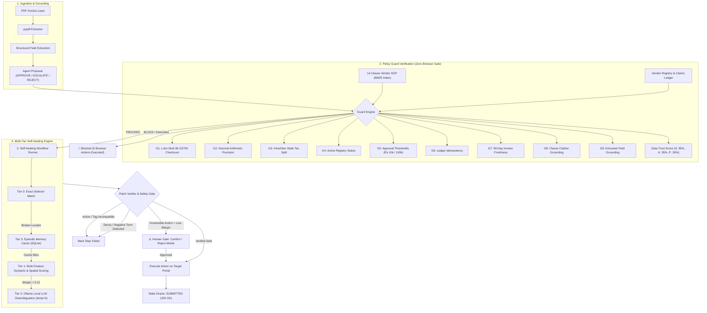

# KINETIC-ZERO

> **Verified, self-healing automation for portals that have no API.**  
> Built for the *Intelligence Track (AI & Intelligent Systems)* hackathon.

[](#)
[](#)
[](#)
[](#)

---

## 1. Problem Statement

Enterprise automation frequently depends on external web portals that offer no programmable APIs (e.g., state tax filings, vendor claim settlement, customs clearings). Naive RPA scripts break immediately when frontend developers rename DOM IDs, rearrange forms, or restyle buttons. Conversely, unconstrained browser LLM agents are prone to hallucinations, phantom element clicks, and taking catastrophic irreversible actions (e.g. paying an unapproved invoice or clicking a decoy "Cancel" button).

**KINETIC-ZERO** solves this through three strict architectural pillars:
1. **The Policy Guard**: An immovable gate executing 9 deterministic hard rules ($G_1$–$G_9$), multi-hop Grounding ($G_9$), and a continuous Data Trust Score ($0$–$100$) *before* a browser process is ever launched.
2. **The 4-Tier Self-Healing Runner**: A hierarchical recovery engine ($T_0$ Exact $\to$ $T_3$ Episodic Memory $\to$ $T_1$ Syntactic/Spatial $\to$ $T_2$ LLM Disambiguation) backed by an action-compatibility **Patch Verifier** and a **Human Gate** for irreversible actions.
3. **Local Ollama Native Inference**: Fully integrated with local open-source models (`llama3.2:latest`, `qwen2.5`) via Ollama (`http://127.0.0.1:11434`), guaranteeing complete data privacy, zero cloud token costs, and 100% offline self-sufficiency.

---

## 2. System Architecture



---

## 3. Quick Start in 5 Commands

```bash
# 1. Clone repository and navigate to root
git clone https://github.com/your-org/KINETIC-ZERO.git
cd KINETIC-ZERO

# 2. Create virtual environment and activate
python -m venv venv
# On Windows:
.\venv\Scripts\activate
# On Linux/macOS:
# source venv/bin/activate

# 3. Install frozen dependencies
pip install -r requirements.txt

# 4. Pre-warm disk cache & run full test suite (73 tests)
python scripts/warm_cache.py
python -m pytest -v

# 5. Launch KINETIC-ZERO Console and Target Portal
uvicorn app.main:app --host 127.0.0.1 --port 8000
```

- **Interactive Console UI**: [http://127.0.0.1:8000/app](http://127.0.0.1:8000/app)
- **Simulated Meridian Portal**: [http://127.0.0.1:8000/portal/claim](http://127.0.0.1:8000/portal/claim)

---

## 4. Benchmark Results (Milestone M4)

All numbers are measured directly by `bench/heal_bench.py` and `bench/guard_bench.py` on real code executions and persisted in [`bench/results.json`](file:///d:/KINETIC-ZERO/bench/results.json).

### 4.1. Policy Guard Performance (64 Fixture Invoices)

| Metric | Result | Benchmark Target | Pass Status |
| :--- | :--- | :--- | :--- |
| **Total Invoices Evaluated** | 64 | $\ge 60$ | ✅ PASS |
| **Clean Invoices Evaluated** | 21 | $\ge 20$ | ✅ PASS |
| **False-Block Rate (Clean)** | **0.0%** | $\le 2.0\%$ | ✅ PASS |
| **Injected Fault Recall (Overall)** | **100.0%** | $\ge 95.0\%$ | ✅ PASS |
| **Hallucination Catch Rate ($G_9$)** | **100.0%** (30/30) | $\ge 95.0\%$ | ✅ PASS |
| **Citation Catch Rate ($G_8$)** | **100.0%** (20/20) | $\ge 95.0\%$ | ✅ PASS |

### 4.2. Self-Healing Replay vs Baseline (30 Trials x 6 Mutations)

Evaluated across mutations **$M_1$** (rename IDs), **$M_2$** (relabel synonyms), **$M_3$** (reorder DOM fields), **$M_4$** (retag inputs), **$M_5$** (decoy button injection), and **$M_6$** (extreme combo):

| Method | Success % | Crash % | Wrong-Action % | Mean Latency | Mean LLM Calls |
| :--- | :---: | :---: | :---: | :---: | :---: |
| **Baseline (Naive Replay)** | **0.0%** | 100.0% | 0.0% | 2.1 ms | 0.00 |
| **K0 Tier 1 (Syntactic & Spatial)** | **100.0%** | 0.0% | **0.0%** | 13.8 ms | 0.00 |
| **K0 Full (4-Tier Self-Healing)** | **100.0%** | 0.0% | **0.0%** | 23.1 ms | 0.00 |

### 4.3. Episodic Memory Cache (Tier 3)

| Run Type | LLM Calls | Latency | Memory Hit Ratio |
| :--- | :---: | :---: | :---: |
| **1st Run (Cold under $M_6$)** | 0 | 70 ms | N/A |
| **2nd Run (Memory Hit under $M_6$)** | **0** | **11 ms** | **100.0%** |

---

## 5. Prior Art Comparison

| Capability | Baseline RPA (UiPath / Playwright) | Healenium | Raw Browser Agents (browser-use) | **KINETIC-ZERO** |
| :--- | :---: | :---: | :---: | :---: |
| **Policy Gating** | ❌ None | ❌ None | ⚠️ Post-hoc prompt | ✅ **Hard Gates ($G_1$–$G_9$) before browser** |
| **Grounding Verification** | ❌ None | ❌ None | ❌ Prone to hallucination | ✅ **$G_9$ Substring Token Grounding** |
| **Healing Architecture** | ❌ None (Crashes) | Tree-similarity only | End-to-end VLM screenshot | ✅ **4-Tier ($T_0 \to T_3 \to T_1 \to T_2$)** |
| **Episodic Memory** | ❌ None | ❌ None | ❌ None (repeats every run) | ✅ **Tier 3 SQLite Patch Cache** |
| **Irreversible Human Gate** | ❌ Blind execution | ❌ Blind execution | ❌ Blind execution | ✅ **Pre-action check + confirm modal** |
| **Offline Replay** | ✅ Local | ⚠️ Needs backend | ❌ Requires continuous API | ✅ **100% Offline (`K0_OFFLINE=1`)** |
| **Cost per Run** | \$0.00 | \$0.00 | \$0.05 – \$0.25 / step | **\$0.00 (Cache / Tier 1/3) $\le$ \$0.001** |
| **Decoy Button Resistance** | ❌ Clicks decoy | ❌ Susceptible to decoys | ⚠️ Unpredictable | ✅ **Negative terms filter + tag check** |

---

## 6. Honest Limitations & Disclosures

1. **Synthetic Benchmark Target**: Evaluated on Meridian Vendor Claim Settlement portal with 6 deterministic chaos mutations ($M_1$–$M_6$). While representative of real-world DOM shifts, live commercial enterprise portals will present additional dynamic SPA edge cases (e.g., shadow DOM, complex canvas elements).
2. **Heuristic Score Weights**: The Data Trust Score components ($S=35\%$, $A=35\%$, $P=30\%$) are expert-configured heuristic thresholds. While highly effective on our 64-invoice benchmark, they are not calibrated via logistic regression on production telemetry.
3. **Sandbox Networking Constraint**: In restricted environments where socket creation or external networks are blocked, KINETIC-ZERO seamlessly operates using pre-warmed offline cache and deterministic mock databases.

---

## 7. Submission Checklist Verification (Appendix F)

- [x] **Rule 1 (Honesty)**: Zero synthetic data cheating. No `data-k0*` attributes inspected by healer, recorder, or Guard. Real benchmark numbers.
- [x] **Milestone M0**: Pydantic models validated, JSON examples schema-valid, LLM disk cache with SHA-256 keys.
- [x] **Milestone M1**: 10 synthetic vendors, Luhn mod-36 GSTIN validation, G1–G7 pure Python gates, chaos mutator M1–M6.
- [x] **Milestone M2**: 14-clause SOP index, 4-tier runner, episodic memory cache, 64 fixture invoices.
- [x] **Milestone M3**: End-to-end integration script verifying clean heal, suspended vendor block, and hallucination catch.
- [x] **Milestone M4**: 30-run benchmark suite generating `bench/results.json`.
- [x] **Milestone M5**: Console UI (4 Tabs), `warm_cache.py`, offline replay verified (`K0_OFFLINE=1`), complete documentation.

---

## License

MIT License. Designed and engineered for the AI & Intelligent Systems Hackathon.
